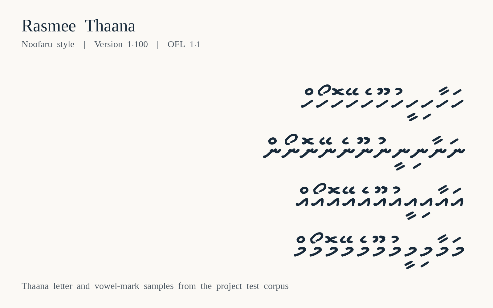

# Rasmee Thaana

An OFL-licensed Thaana typeface project for Dhivehi text. The version proposed for Google Fonts is **Rasmee Thaana, Noofaru style, version 1.100**: rounded entry strokes and a 10-degree left slant, with Latin glyphs from Liberation Serif and Bismillah calligraphy from Amiri.

The intended use is readable, editable Dhivehi documents, spreadsheets, and presentations. This repository supports a request for Google Fonts onboarding and consideration for availability in Google Docs, Sheets, and Slides. Publication here does not mean Google has accepted the font or enabled it in those applications.

## Fonts

- Proposed font: [`dist/rasmee-noofaru-style/RasmeeThaana-NoofaruStyle.ttf`](dist/rasmee-noofaru-style/RasmeeThaana-NoofaruStyle.ttf), version 1.100. This is the supplied font, unchanged.
- Original upright design: [`dist/RasmeeThaana-Regular.ttf`](dist/RasmeeThaana-Regular.ttf), version 1.007, also under OFL.
- Both currently declare family **Rasmee Thaana**, style **Regular**, and PostScript name **RasmeeThaana-Regular**. Install only one version at a time. Google Fonts naming and style conventions need review before onboarding.
- The supplied font has 295 glyphs, 278 mapped Unicode code points, and all 50 assigned Thaana characters (U+0780–U+07B1).



## License and provenance

See [OFL.txt](OFL.txt). Copyright attribution is retained for Rasmee Thaana Project Authors, Liberation Serif, and Amiri. Upstream license notices include Reserved Font Names for the Liberation lineage; this font does not use those names as its family name. Please review the upstream notices in `latin/` rather than removing them.

The original project documentation describes generated Thaana pen-stroke skeletons and comparisons/fitting to measurements of Faruma. It states that the President's Office authorized those measurements and that no Faruma outline points were copied. That is the supplied project's provenance statement; documentary evidence of that permission and its scope for a public OFL release is not included here. Its original release notes ask for confirmation of OFL distribution with the President's Office. No proprietary Faruma or Noofaru font file is included in this repository.

Repository preparation, build verification, and the submission request were assisted by AI. The complete history of AI involvement in the underlying design has not been independently established; the maintainer should supply that history during onboarding. This repository makes no sole-authorship or completed-CLA certification.

## Sources and build

The active design sources are procedural Python in `src/thaana.py` and `tools/stroke.py`, together with `spec/` and the licensed inputs in `latin/`. `tools/noofaru_slant.py` applies the proposed font's final transformation. These are the actual supplied development sources, not a reconstruction from the output font.

The existing upright build is documented in [BUILD.txt](BUILD.txt). To rebuild the proposed Noofaru style:

```sh
python3 -m venv .venv
.venv/bin/python -m pip install -r requirements.txt
.venv/bin/python tools/rebuild_noofaru.py
```

The source environment was CPython 3.10.8. The wrapper builds into a temporary directory, fixes the original modification timestamp, verifies the exact SHA-256, and writes `build/RasmeeThaana-NoofaruStyle.ttf` only if it reproduces the supplied font. It does not overwrite the supplied release.

Original engineering and test notes are retained in [dist/README.txt](dist/README.txt) and [the variant notes](dist/rasmee-noofaru-style/README.txt). Those notes describe previous project checks; they are not a Fontspector Google Fonts pass.

## Google Fonts onboarding status

This is an initial review/technical-assistance request under the [Google Fonts contribution process](https://github.com/google/fonts/blob/main/CONTRIBUTING.md). Outstanding work includes:

- Copyright-holder CLA completion and confirmation of the provenance/permission statement above.
- Name uniqueness and acceptance of the current family/style names. The family includes a script name, which the onboarding guide ordinarily disallows; guidance or a rename is needed.
- UFO conversion and a Fontmake build, or an exception for the procedural source/build.
- GF Latin Core coverage review, Google Fonts metadata, and Fontspector `googlefonts` profile checks and fixes.
- Google design review and a decision on Google Workspace availability.

Unchecked requirements must remain unchecked until verified. See [Google's onboarding guide](https://googlefonts.github.io/gf-guide/onboarding.html) and [CLA portal](https://cla.developers.google.com/).

